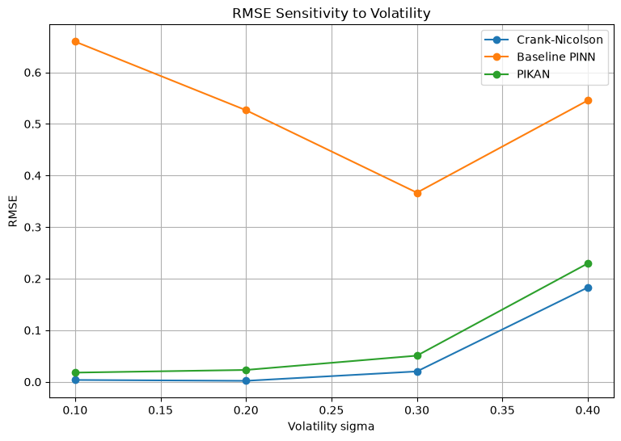
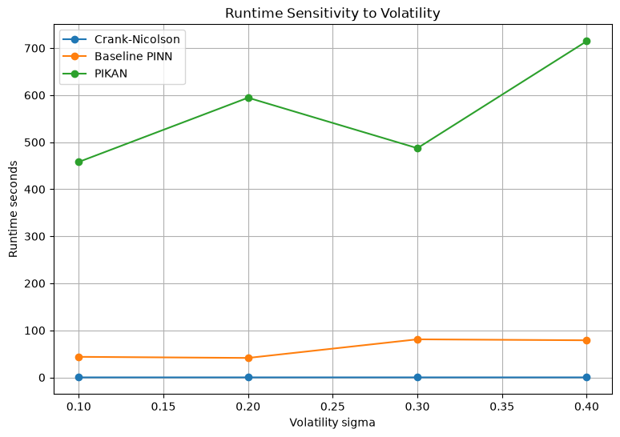

## Overview

Can physics-informed neural networks compete with a classical
numerical solver for option pricing? In this project, I implemented
and compared three approaches to pricing European call options:
Crank–Nicolson, a physics-informed neural network (PINN), and a
physics-informed Kolmogorov–Arnold network (PIKAN).

For the one-dimensional Black–Scholes problem tested,
Crank–Nicolson achieved the lowest pricing errors and shortest
runtime. PIKAN improved substantially on the baseline PINN’s
accuracy, but required considerably more training time.

## Why this problem?

Black–Scholes provides a useful controlled benchmark because
European call prices have an analytical solution. This makes it
possible to measure approximation errors directly rather than
compare numerical methods against another approximate reference.

The aim was to investigate the accuracy and computational cost
of physics-informed learning in a setting where a strong
classical method already exists.

## How I compared the methods

Crank–Nicolson approximates the pricing equation on a grid,
solving a tridiagonal linear system at each time step. The
PINN instead represents the price function with a multilayer
perceptron, trained to satisfy the differential equation and
its initial and boundary conditions. The PIKAN uses the same
physics-informed principle with a spline-based Kolmogorov–Arnold
network.

For the main experiment, I used a strike price of 100, a
one-year maturity, a 5% risk-free rate and 20% volatility.
All methods were assessed against analytical prices on the
same 100 × 50 evaluation grid.

I evaluated several PINN configurations and two PIKAN training
lengths. Performance measures included root mean squared error
(RMSE), maximum absolute error, relative L2 error and runtime.

## Main findings

In the main comparison, Crank–Nicolson achieved an RMSE of
approximately 0.0098 in 0.29 seconds. The baseline PINN achieved
approximately 0.501 in 33.7 seconds, while the PIKAN trained
for 3,000 epochs achieved approximately 0.0581 in 257.6 seconds.

The PIKAN therefore offered a clear accuracy improvement over
the baseline PINN, although Crank–Nicolson remained both faster
and more accurate. Increasing PINN width or adding a learning-rate
scheduler did not consistently improve performance, illustrating
the importance of testing implementation choices.

### Sensitivity to volatility

In a separate sensitivity experiment, I tested volatility values
from 10% to 40%. Crank–Nicolson retained the lowest RMSE at every
tested value, and PIKAN consistently improved on the baseline PINN.

{width=100%}

Errors increased noticeably for both Crank–Nicolson and PIKAN
at 40% volatility. This motivates further investigation of
resolution, boundary effects and training choices.

The runtime comparison shows that PIKAN’s improvement over the
baseline PINN came at substantial computational cost.
Crank–Nicolson runtimes were positive but too small to distinguish
clearly on the plotted scale.

{width=100%}

## What I learned and limitations

The main lesson was the value of a strong numerical baseline.
Learning the overall shape of a price surface is not sufficient:
accuracy and computational cost must also justify the approach.

These results concern the implementations and problem tested.
The neural models differed in parameter counts, training points
and training lengths, so the comparison does not isolate
architecture alone. Experiments used a laptop without a dedicated
CUDA-enabled GPU, and fixed seeds rather than repeated trials
across multiple seeds. Reported runtimes concern solving or
training, rather than a separate inference-speed benchmark.

The study excludes stochastic volatility, dividends and early
exercise. A natural extension is to investigate how the
accuracy–cost trade-off changes as problem dimensionality
increases, using matched computational budgets and repeated runs.

## Code and report

[View the code](https://github.com/dylan-sinnott/black-scholes-pinn-pikan-benchmark) ·
[Read the full report](files/option-pricing-report.pdf)

[Back to projects](projects.qmd)